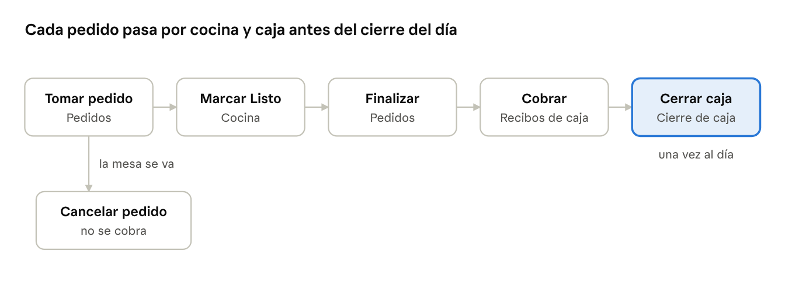

# Manual de usuario

## Hoja de control

| Campo | Valor |
| --- | --- |
| Documento | Manual de Usuario |
| Proyecto | Sistema de Gestión para Restaurante |
| Versión | 1.1 |
| Fecha | 25/11/2026 |
| Elaborado por | Equipo MRGG: Sebastian Mora Osorio, María Camila Ramirez Caro, María de los Ángeles Gutiérrez López y Juan Sebastián Granados Gómez |
| Asignatura | [Por completar] |
| Docente | [Por completar] |
| Dirigido a | Administradores y auxiliares del restaurante (meseros, cocina y caja) |

### Control de modificaciones

| Versión | Fecha | Autor | Descripción del cambio |
| --- | --- | --- | --- |
| 1.1 | 25/11/2026 | Equipo MRGG | Estructura según las guías de manual de usuario, capturas de pantalla, mensajes de error, navegación, preguntas frecuentes y glosario |
| 1.0 | 19/11/2026 | Equipo MRGG | Versión inicial |

## Contenido

1. Introducción y descripción del sistema (esta página)
2. [Interfaz de trabajo](interfaz-de-trabajo.md)
3. [Usuarios y perfiles](usuarios-y-perfiles.md)
4. [Operativa: Inicio, Pedidos y Cocina](operativa-pedidos-y-cocina.md)
5. [Operativa: Recibos, Egresos y Cierre de caja](operativa-caja.md)
6. [Operativa: PQRS, catálogos y usuarios](operativa-pqrs-catalogos-usuarios.md)
7. [Anexos](anexos.md)
8. [Glosario](glosario.md)

## 1. Introducción

Este manual explica, paso a paso, cómo usar el Sistema de Gestión para Restaurante en el trabajo diario: tomar pedidos, preparar comandas, cobrar, registrar gastos, cerrar la caja y atender las PQRS de los clientes. Está escrito para personas sin conocimientos técnicos, desde el administrador hasta el mesero.

### 1.1 Objeto y alcance

**Objeto:** que cada usuario pueda entrar al sistema, encontrar la pantalla que necesita y completar sus tareas sin ayuda, sabiendo qué hacer cuando aparece un mensaje de error.

**Alcance:** cubre todas las pantallas que ve el usuario final, en sus dos perfiles (Administrador y Auxiliar). No cubre la instalación del servidor, la base de datos ni el código fuente: eso corresponde a la documentación técnica de este mismo sitio.

**Por qué es importante:** el sistema maneja dinero (cobros, egresos y cierre de caja) y aplica reglas que protegen esa información. Conocerlas evita cobros dobles, cierres descuadrados y bloqueos innecesarios.

### 1.2 Documentos relacionados

| Id | Nombre | Descripción |
| --- | --- | --- |
| REF-01 | [Guía de Elaboración del Manual de Usuario, Junta de Andalucía](https://www.juntadeandalucia.es/medioambiente/portal/documents/13391456/31733850/Manual+de+Usuario+%28Gu%C3%ADa%29.pdf/634b1bbe-9d63-d63d-0925-36a1e295756e?t=1640767586997) | Estructura de capítulos y anexos que sigue este manual |
| REF-02 | [Plantilla de Manual de Usuario, UNPA](https://www.uarg.unpa.edu.ar/psi/psi/guidances/templates/plantilla_manual_de_usuario_4DFD99.html) | Introducción, ingreso al sistema, componentes de interfaz y guía rápida de botones |
| REF-03 | [Cómo crear un manual de usuario, TechSmith](https://www.techsmith.es/blog/manual-usuario/) | Buenas prácticas: lenguaje sencillo, capturas, pasos numerados e índice |
| REF-04 | [Guía para la Elaboración del Manual Técnico y de Operación del Sistema, DNP](https://colaboracion.dnp.gov.co/CDTI/Oficina%20Informatica/Sistemas%20de%20informaci%C3%B3n/Gu%C3%ADas%20Formatos%20Plantillas/Gu%C3%ADa%20para%20la%20Elaboraci%C3%B3n%20del%20Manual%20T%C3%A9cnico%20y%20de%20Operaci%C3%B3n%20del%20Sistema.pdf) | Guía de referencia del curso |
| REF-05 | Instalación y configuración de aplicaciones informáticas (Paraninfo), p. 67 | Objetivo y contenido de un manual de usuario |
| DOC-01 | `database/README.md` del proyecto | Instalación de la base de datos y migraciones (manual técnico) |

### 1.3 Convenciones de este manual

* Los botones, campos y opciones del menú van en **negrita**, tal como aparecen en pantalla. Por ejemplo, **+ Nuevo pedido**.
* Los pasos que se hacen en orden van numerados.
* Las capturas de pantalla se identifican como _Figura N_ y usan datos de demostración, no datos reales de clientes.
* **Nota:** las notas en negrita advierten reglas del sistema que conviene recordar.

## 2. Descripción del sistema

El Sistema de Gestión para Restaurante es una aplicación web que registra todo lo que pasa en el restaurante durante el día, desde que una mesa pide hasta que se cierra la caja. Se usa desde el navegador y guarda la información en una base de datos MySQL.

### Módulos

| Módulo | Qué resuelve |
| --- | --- |
| Inicio | Resumen del día: ventas, pedidos abiertos, cobros pendientes, PQRS y materias primas por reponer |
| Pedido | Toma de pedidos por mesa, comandas de cocina, platos, categorías y materias primas |
| Recibo de caja | Cobro de pedidos, cierre de caja diario y clientes |
| Comprobante de egreso | Salidas de dinero, conceptos y formas de pago |
| PQRS | Peticiones, quejas, reclamos y sugerencias, con página pública para los clientes |
| Configuración | Usuarios, roles y estados del sistema |

<figure><figcaption>
Figura 1. Recorrido de un pedido durante el día
</figcaption></figure>

El mesero toma el pedido, la cocina marca cada plato como listo, el pedido se finaliza y se cobra. Al final del día se cierra la caja. Si la mesa se va sin consumir, el pedido se cancela y no se cobra.

### Requisitos para usarlo

* Un computador o tableta con navegador actualizado: Chrome, Edge o Firefox.
* Conexión con el computador donde está instalado el sistema.
* En ese computador, MySQL encendido desde el panel de XAMPP y la aplicación en ejecución.
* Un usuario y una contraseña creados por el administrador.


Apaga MySQL con **Stop** en XAMPP antes de apagar el computador del sistema. Apagarlo de golpe puede dañar la base de datos.

