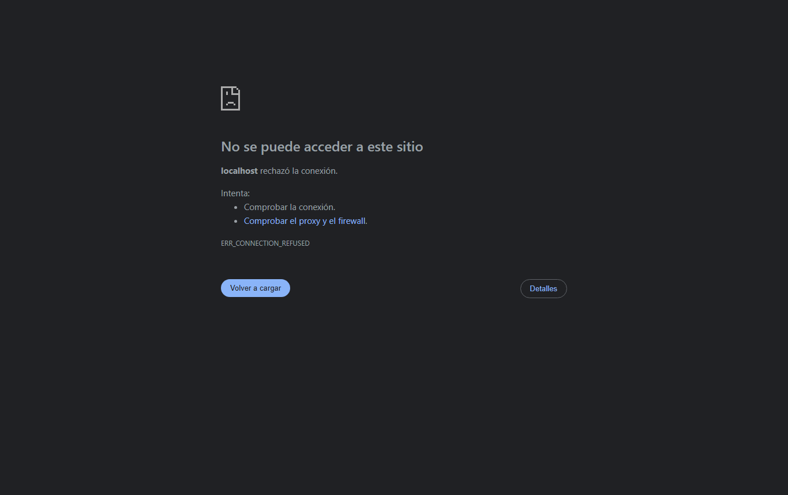
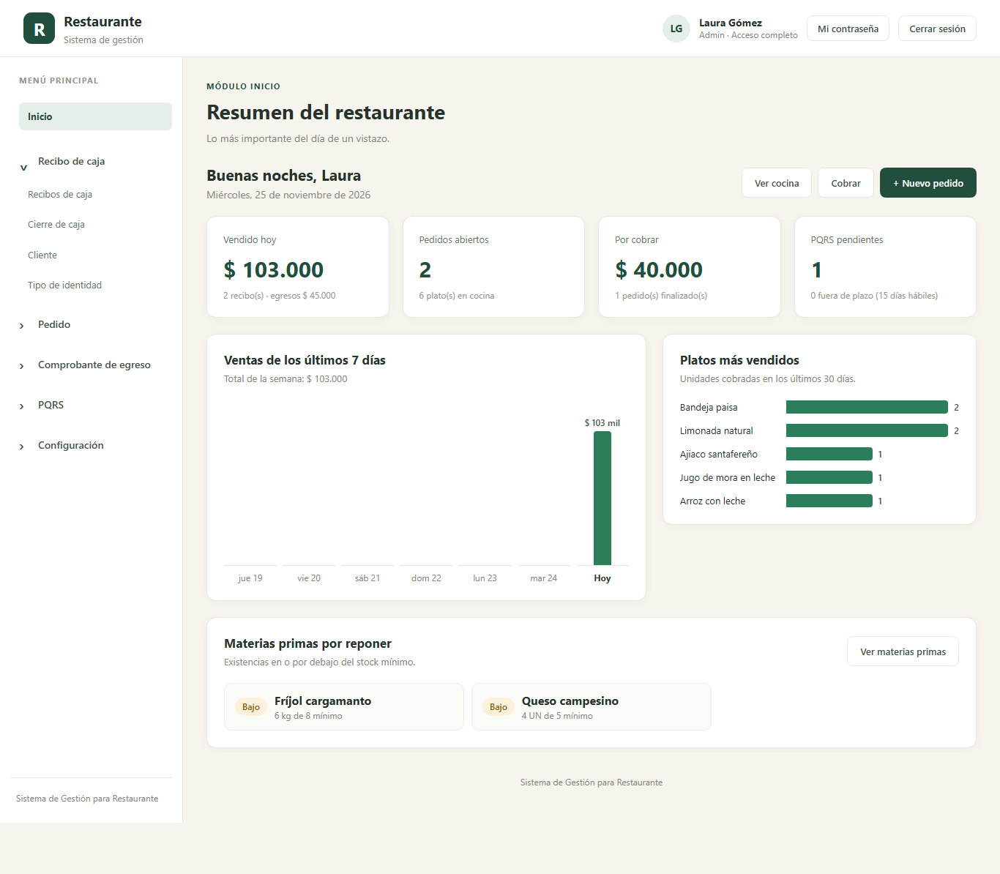

# 3. Interfaz de trabajo

## 3.1 Entrar y salir del sistema

Para entrar:

1. Abre el navegador y escribe la dirección que te dio el administrador. En el mismo computador donde corre el sistema es `http://localhost:8080`.
2. Escribe tu **usuario** y tu **contraseña**. El botón **Ver** muestra u oculta la contraseña.
3. Pulsa **Ingresar**. Llegas a la pantalla de **Inicio**.

<figure><figcaption>
Figura 2. Pantalla de inicio de sesión
</figcaption></figure>

Para salir, pulsa **Cerrar sesión** en la parte superior derecha. Si no usas el sistema durante 60 minutos, la sesión se cierra sola y debes volver a entrar.

## 3.2 Partes de la pantalla

Después de entrar, todas las pantallas tienen tres zonas:

1. **Cabecera (arriba):** el nombre del sistema, tu nombre con tu rol, y los botones **Mi contraseña** y **Cerrar sesión**.
2. **Menú principal (izquierda):** los módulos del sistema. Cada grupo se abre o se cierra con un clic y muestra sus pantallas.
3. **Área de trabajo (centro):** arriba dice el módulo y el título de la pantalla. Debajo hay tarjetas con totales y, más abajo, los formularios y listados.

<figure><figcaption>
Figura 3. Pantalla principal con cabecera, menú y área de trabajo
</figcaption></figure>

## 3.3 Menú principal

| Grupo del menú | Pantallas que contiene |
| --- | --- |
| Inicio | Resumen del restaurante |
| Recibo de caja | Recibos de caja, Cierre de caja, Cliente, Tipo de identidad |
| Pedido | Pedidos, Cocina / Comandas, Platos, Categorías, Materias primas, Categorías de insumo, Unidades de medida |
| Comprobante de egreso | Comprobantes de egreso, Concepto de pago, Forma de pago |
| PQRS | Bandeja de PQRS, Tipo de PQRS |
| Configuración | Usuario, Rol, Estados |

El menú solo muestra las opciones que tu perfil puede usar (ver [Usuarios y perfiles](usuarios-y-perfiles.md)).

## 3.4 Guía rápida de botones

| Botón | Qué hace |
| --- | --- |
| **+ Nuevo** (pedido, cliente, plato…) | Abre el formulario para crear un registro |
| **Guardar** / **Registrar** / **Enviar a cocina** | Guarda lo que escribiste en el formulario |
| **Cancelar** / **Cerrar** | Cierra el formulario sin guardar |
| **Editar** | Abre el registro para corregirlo |
| **Activar** / **Inactivar** | Habilita o deshabilita un registro. Nada se borra del sistema |
| **Ver** | Muestra el detalle de un pedido, recibo o PQRS |
| **Actualizar listado** | Vuelve a cargar los datos de la pantalla |
| **Abiertos / Finalizados / Hoy / Todos** | Filtran el listado |
| **Listo** | En Cocina, marca un plato como preparado |
| **Cobrar** | Abre el cobro de un pedido finalizado |
| **Anular** | Anula un recibo o egreso con un motivo (solo administrador) |
| **Imprimir** | Imprime el recibo o el cierre, o lo guarda como PDF |
| **Mi contraseña** | Cambia tu contraseña |
| **Cerrar sesión** | Sale del sistema |
