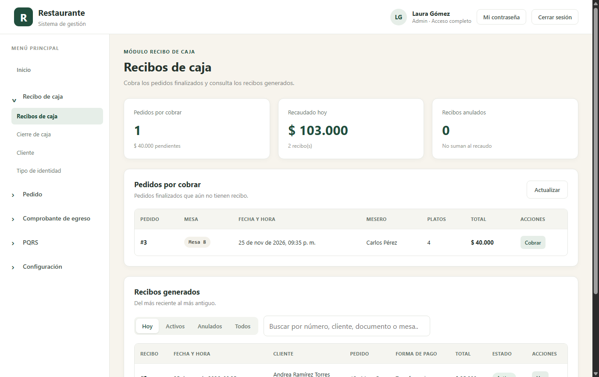
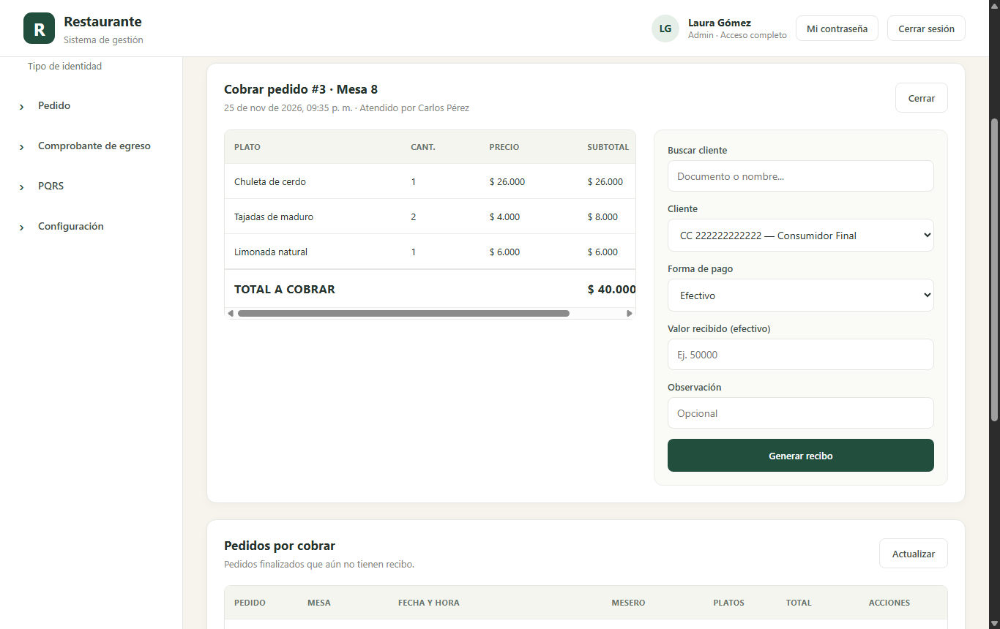
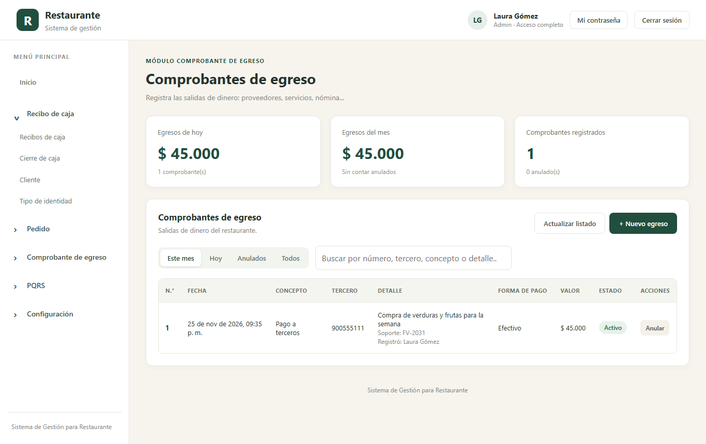
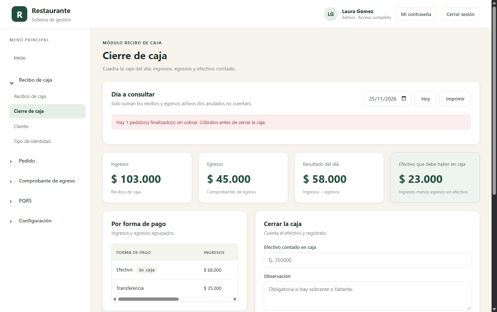

# 5. Operativa: Recibos, Egresos y Cierre de caja

## 5.4 Recibos de caja

**Qué muestra:** arriba, los **Pedidos por cobrar** (pedidos finalizados sin recibo). Abajo, los **Recibos generados**, con filtros **Hoy**, **Activos**, **Anulados** y **Todos**.

<figure><figcaption>
Figura 9. Pantalla de Recibos de caja
</figcaption></figure>

**Acciones permitidas:** cobrar un pedido, ver e imprimir un recibo y, solo el administrador, anularlo.

**Cobrar un pedido:**

1. Pulsa **Cobrar** en el pedido. Ves sus platos y el total. Los platos cancelados no se cobran.
2. Elige el **Cliente**. Si no da sus datos, deja **Consumidor final**, que viene seleccionado. Para buscar uno registrado, escribe su nombre o documento en **Buscar cliente**.
3. Elige la **Forma de pago** (Efectivo o Transferencia).
4. Si paga en efectivo, escribe el **Valor recibido** y el sistema calcula el cambio.
5. Pulsa **Generar recibo**. Puedes **Imprimir** el recibo o guardarlo como PDF.

<figure><figcaption>
Figura 10. Cobro de un pedido
</figcaption></figure>


Cada pedido se cobra una sola vez. El total usa los precios del momento en que se tomó el pedido.


**Anular un recibo (solo administrador):** abre el recibo con **Ver**, pulsa **Anular** y escribe el motivo (mínimo 5 caracteres). El recibo deja de sumar en las ventas y el pedido vuelve a **Pedidos por cobrar** para cobrarlo bien.

## 5.5 Comprobantes de egreso

**Qué muestra:** las salidas de dinero del restaurante (pagos a proveedores, servicios públicos o nómina), con totales del día y del mes.

<figure><figcaption>
Figura 11. Pantalla de Comprobantes de egreso
</figcaption></figure>

**Acciones permitidas:** el administrador registra y anula egresos. El auxiliar solo los consulta.

**Registrar un egreso:**

1. Pulsa **+ Nuevo egreso**.
2. Elige el **Concepto** y la **Forma de pago**, y escribe el **Valor**.
3. Escribe la **Identificación del tercero** (a quién se le paga): de 4 a 15 letras, números o guion.
4. Si hay factura o cuenta de cobro, escribe su número en **Documento soporte**.
5. En **Detalle**, explica el pago (máximo 250 caracteres) y pulsa **Registrar egreso**.

El número del comprobante, la fecha y quién lo registró se guardan solos. Para anular uno, pulsa **Anular** y escribe el motivo.

## 5.6 Cierre de caja

**Qué muestra:** los ingresos, los egresos, el resultado del día y el **Efectivo que debe haber en caja** (ingresos menos egresos en efectivo), separados por forma de pago, y todos los movimientos del día.

<figure><figcaption>
Figura 12. Pantalla de Cierre de caja
</figcaption></figure>

**Acciones permitidas:** registrar el cierre del día, consultar días anteriores en **Día a consultar** e **Imprimir** el resumen.

**Cerrar la caja:**

1. Cobra todos los pedidos finalizados. La pantalla avisa si quedan pedidos sin cobrar.
2. Cuenta el dinero y escríbelo en **Efectivo contado en caja**. Si no hay efectivo, escribe 0.
3. Si hay sobrante o faltante, la **Observación** es obligatoria: explica la diferencia.
4. Pulsa **Registrar cierre**.


Después del cierre, la caja de ese día queda bloqueada. Ya no se pueden cobrar pedidos, registrar egresos ni anular recibos o egresos de ese día. Cada día se cierra una sola vez.

