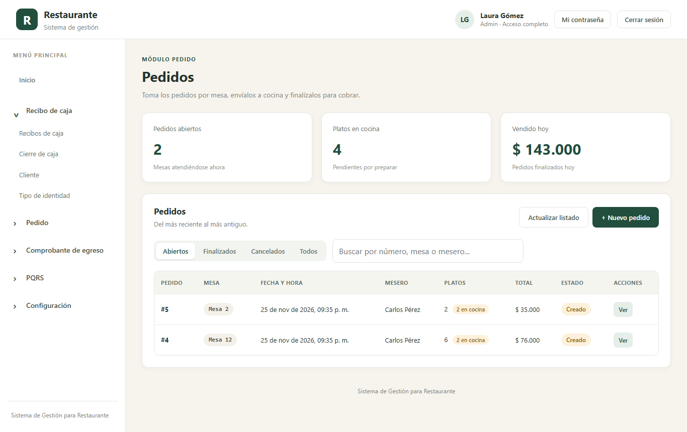
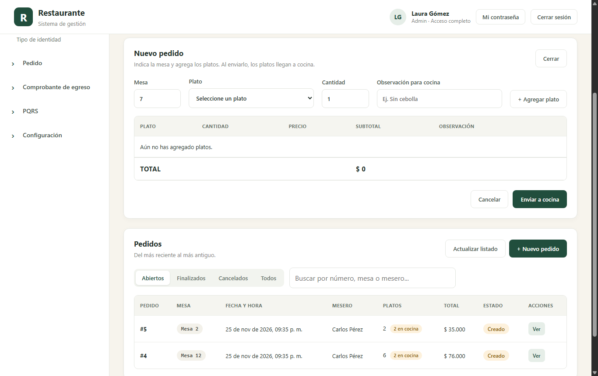
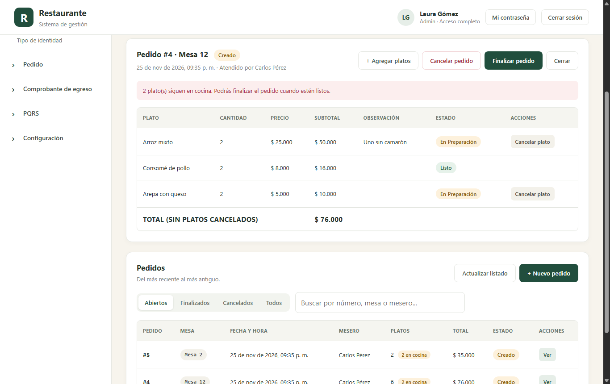
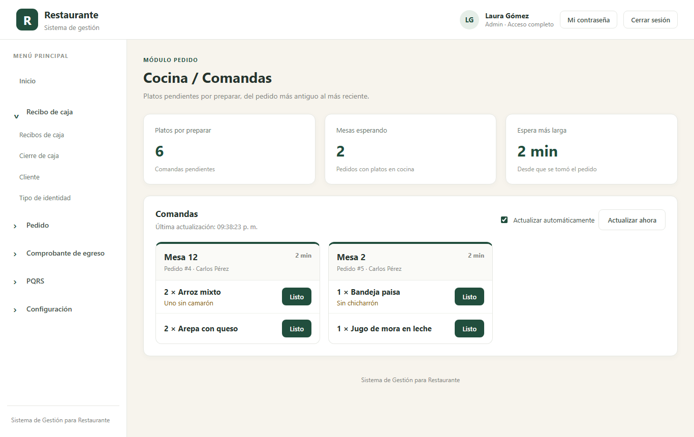

# 5. Operativa: Inicio, Pedidos y Cocina

Este capítulo describe cada pantalla: qué muestra, qué acciones permite y los pasos para hacerlas. Las pantallas siguen el orden del trabajo del día (Figura 1).

## 5.1 Inicio

**Qué muestra:** el resumen del día en una sola vista (Figura 3). Es la primera pantalla al entrar.

* **Vendido hoy:** suma de los recibos activos del día y el total de egresos.
* **Pedidos abiertos:** mesas que se están atendiendo y platos que siguen en cocina.
* **Por cobrar:** pedidos finalizados que todavía no tienen recibo.
* **PQRS pendientes:** las que faltan por responder y cuántas pasan de 15 días hábiles.
* **Ventas de los últimos 7 días** y **Platos más vendidos** en los últimos 30 días.
* **Materias primas por reponer:** las que están en su stock mínimo o por debajo.

**Acciones permitidas:** los botones **Ver cocina**, **Cobrar** y **+ Nuevo pedido** llevan directo a esas pantallas.

## 5.2 Pedidos

**Qué muestra:** los pedidos de las mesas con su mesero, número de platos, total y estado. Al enviar un pedido, sus platos llegan solos a Cocina.

<figure><figcaption>
Figura 5. Listado de pedidos abiertos
</figcaption></figure>

**Acciones permitidas:** crear un pedido, agregar platos a un pedido abierto, cancelar un plato que sigue en preparación, finalizar o cancelar el pedido, y filtrar por **Abiertos**, **Finalizados**, **Cancelados** o **Todos**.

**Crear un pedido:**

1. En el menú, abre **Pedido** → **Pedidos** y pulsa **+ Nuevo pedido**.
2. Escribe la **Mesa**: hasta 4 letras o números, por ejemplo `5` o `T2`.
3. Elige el **Plato**, la **Cantidad** (de 1 a 50) y, si hace falta, una **Observación para cocina** como «sin cebolla» (máximo 100 caracteres).
4. Pulsa **+ Agregar plato**. Repite para cada plato. Abajo ves el total.
5. Pulsa **Enviar a cocina**.

<figure><figcaption>
Figura 6. Formulario de nuevo pedido
</figcaption></figure>


Solo aparecen los platos en estado Disponible, y cada mesa puede tener un solo pedido abierto.


**Agregar platos, finalizar o cancelar:** en el listado, pulsa **Ver** en el pedido. En el detalle (Figura 7) están los botones **+ Agregar platos**, **Finalizar pedido** y **Cancelar pedido**, y junto a cada plato en preparación, **Cancelar plato**.

* **Finalizar pedido:** cuando la mesa terminó. Todos los platos deben estar listos o cancelados. Después el pedido pasa a Recibos de caja para cobrarlo.
* **Cancelar pedido:** cuando la mesa se va sin consumir. Los platos que seguían en preparación se cancelan.

<figure><figcaption>
Figura 7. Detalle de un pedido con platos en preparación y listos
</figcaption></figure>


Un pedido finalizado o cancelado ya no se puede modificar.


## 5.3 Cocina / Comandas

**Qué muestra:** los platos que faltan por preparar, agrupados por mesa, con la cantidad, la observación del mesero y los minutos de espera.

<figure><figcaption>
Figura 8. Pantalla de Cocina con las comandas por mesa
</figcaption></figure>

**Acciones permitidas:**

1. Prepara el plato.
2. Pulsa **Listo** junto a ese plato. Desaparece de la lista y el mesero lo ve como listo en su pedido.

La pantalla se actualiza sola cada 15 segundos. Para pausarla, desmarca **Actualizar automáticamente**, o pulsa **Actualizar ahora** cuando quieras. Si un plato no se puede preparar, el mesero lo cancela desde el detalle del pedido.
