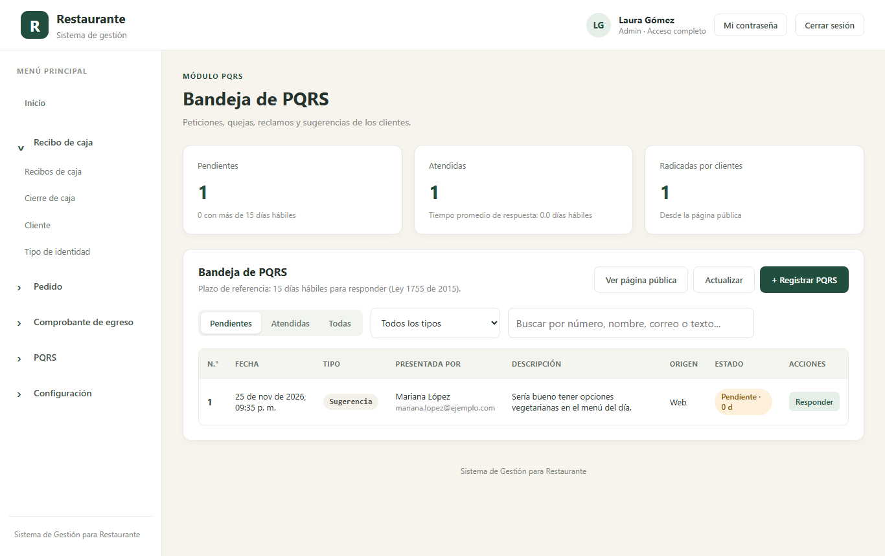
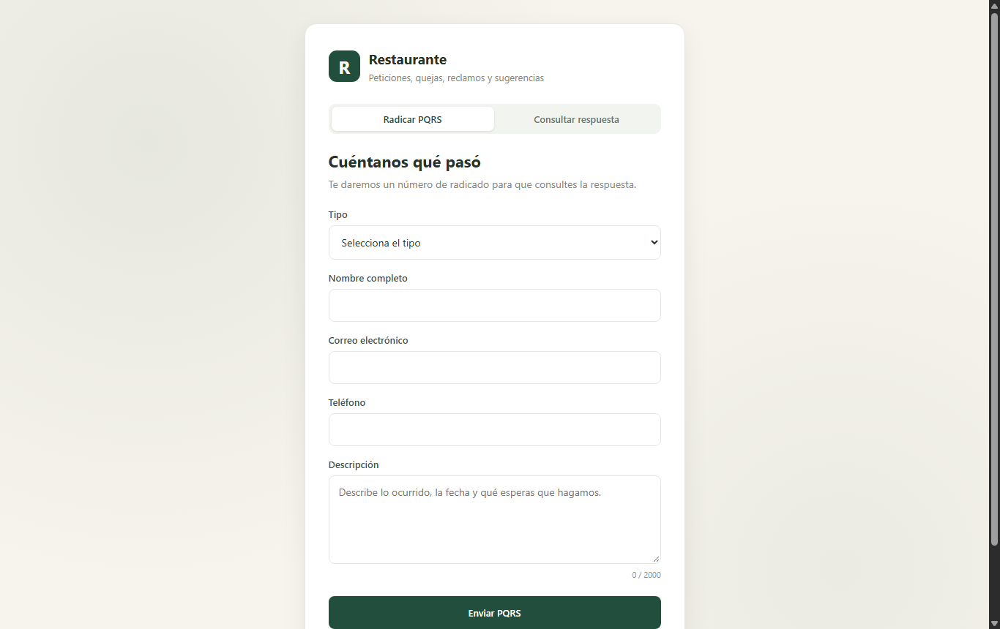
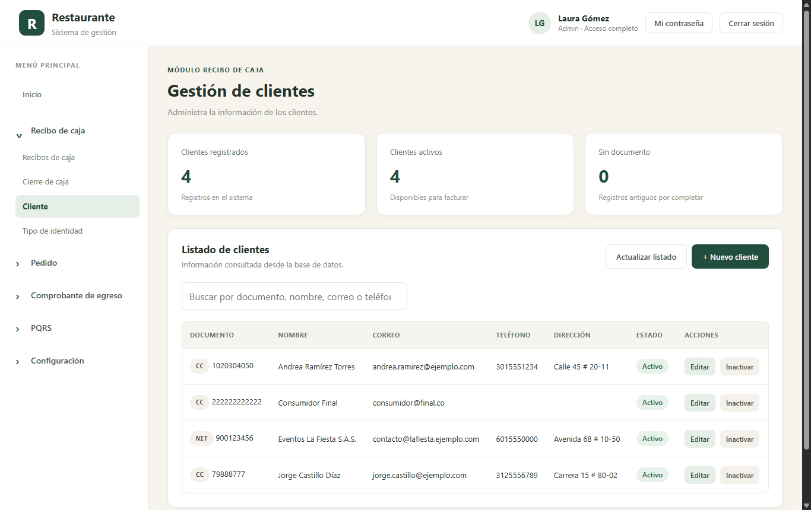
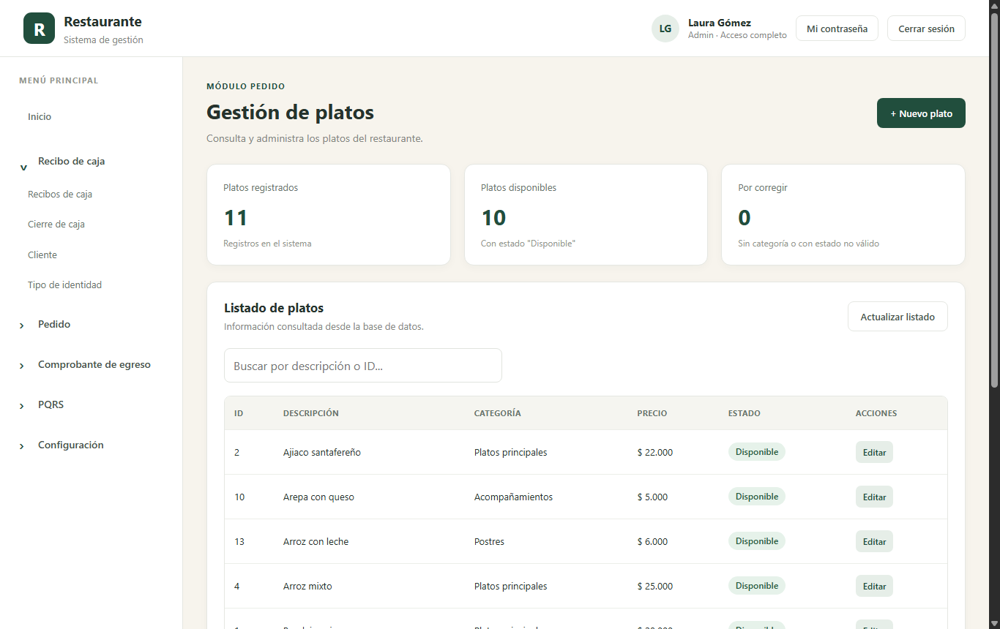
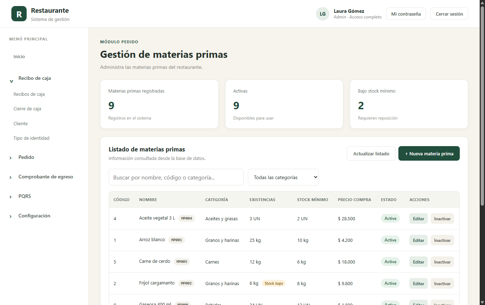
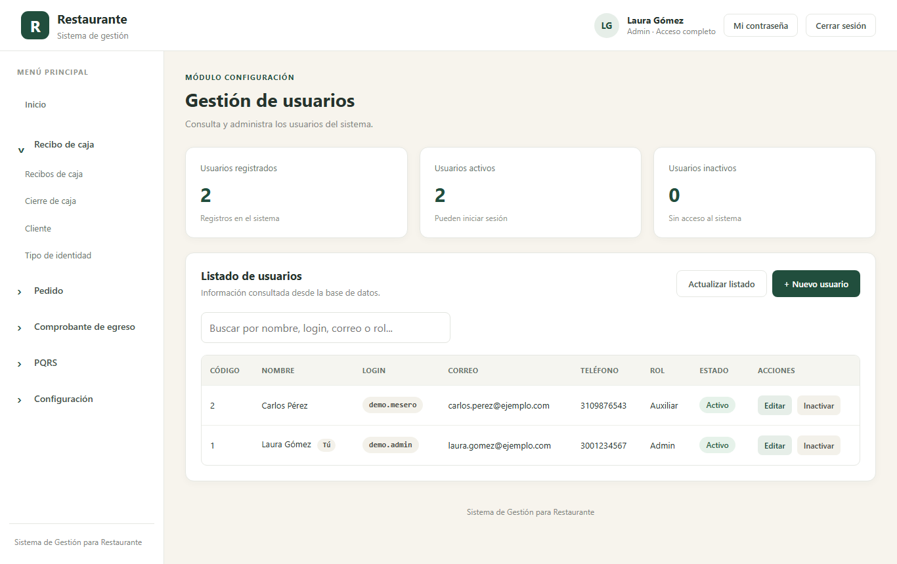
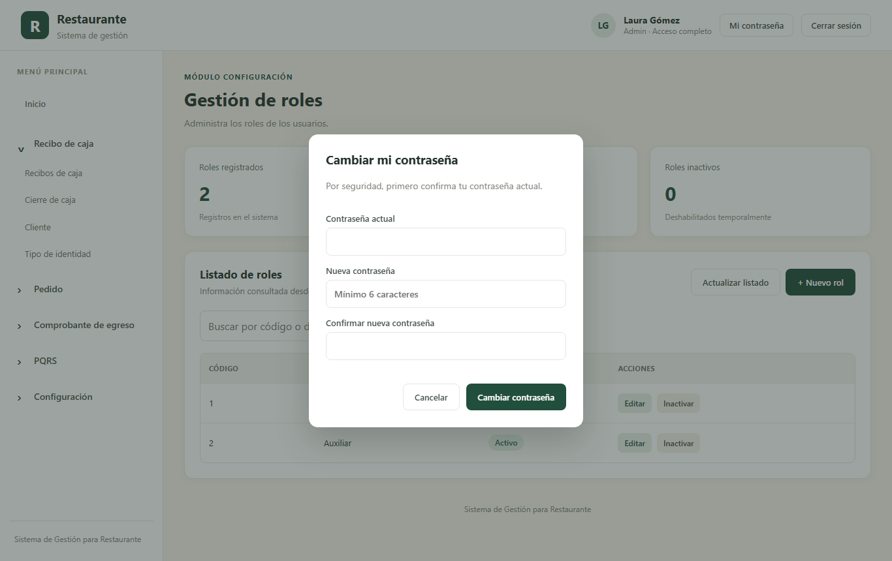

# 5. Operativa: PQRS, catálogos y usuarios

## 5.7 PQRS

**Qué muestra:** la **Bandeja de PQRS** con las peticiones, quejas, reclamos y sugerencias de los clientes. Las pendientes salen primero y se marcan las que pasan de 15 días hábiles, el plazo de referencia de la Ley 1755 de 2015.

<figure><figcaption>
Figura 13. Bandeja de PQRS
</figcaption></figure>

**Acciones permitidas:** responder una PQRS, registrar la que un cliente presenta en persona o por teléfono, y abrir la página pública.

**Responder una PQRS:**

1. Pulsa **Responder** en la PQRS pendiente.
2. Escribe la respuesta (mínimo 10 caracteres).
3. Pulsa **Responder y marcar como atendida**. El cliente la ve en la página pública.

Para registrar una PQRS en nombre del cliente, pulsa **+ Registrar PQRS**, completa tipo, nombre, correo, teléfono y descripción, y pulsa **Radicar PQRS**.

**Página pública para el cliente (sin usuario):**

1. En la pantalla de inicio de sesión, el cliente pulsa **Radica tu PQRS aquí**.
2. En **Radicar PQRS** elige el tipo, escribe su nombre, correo, teléfono y qué pasó, y pulsa **Enviar PQRS**.
3. Recibe un **número de radicado**. Con ese número y su correo, en **Consultar respuesta**, ve el estado y la respuesta.

<figure><figcaption>
Figura 14. Página pública de PQRS
</figcaption></figure>


Desde un mismo equipo se pueden enviar máximo 5 PQRS por hora.


## 5.8 Clientes, platos, materias primas y catálogos

**Qué muestran:** los datos que usan las demás pantallas. Todas funcionan igual: tarjetas con totales, un buscador y un listado.

**Acciones permitidas:** **+ Nuevo** para crear, **Editar** para corregir, **Activar/Inactivar** para dejar de usar un registro sin borrarlo.

| Pantalla | Para qué sirve |
| --- | --- |
| Cliente | Datos de quien se factura: tipo y número de documento (no se repiten), nombre, correo, teléfono y dirección |
| Platos | Lo que se vende: nombre, categoría, precio y estado |
| Categorías | Grupos del menú: bebidas, entradas, platos principales, postres |
| Materias primas | Insumos con categoría, unidad, precio de compra, existencias y stock mínimo |
| Categorías de insumo y Unidades de medida | Grupos y unidades de las materias primas |
| Tipo de identidad | CC, NIT, CE y demás documentos |
| Concepto de pago y Forma de pago | Opciones para egresos y recibos |
| Tipo de PQRS | Petición, queja, reclamo y sugerencia |
| Estados | Estados de pedidos, platos, comandas y PQRS |

<figure><figcaption>
Figura 15. Gestión de clientes
</figcaption></figure>

<figure><figcaption>
Figura 16. Gestión de platos
</figcaption></figure>

<figure><figcaption>
Figura 17. Gestión de materias primas
</figcaption></figure>


Un plato solo se puede pedir si su estado es **Disponible**. Si se acaba, cámbialo a **Agotado** y deja de aparecer en Pedidos. En **Estados** no cambies los que usa el flujo (Creado, Finalizado, Cancelado, En preparación, Disponible, Pendiente, Atendida): si los cambias, los pedidos o las PQRS dejan de avanzar.


## 5.9 Usuarios, roles y contraseña

**Qué muestra:** en **Configuración** → **Usuario**, las personas que pueden entrar al sistema, con su usuario, correo, rol y estado. Solo el administrador ve esta opción.

<figure><figcaption>
Figura 18. Gestión de usuarios
</figcaption></figure>

**Crear un usuario:**

1. Pulsa **+ Nuevo usuario**.
2. Escribe sus datos, el **usuario** con el que entrará, una contraseña inicial (mínimo 6 caracteres) y su **rol** (Admin o Auxiliar).
3. Entrégale la contraseña en persona y pídele que la cambie al entrar.

Si alguien deja de trabajar en el restaurante, **inactiva** su usuario: ya no podrá entrar, pero sus pedidos y recibos quedan registrados a su nombre. En **Rol** se crean o inactivan los roles. Si alguien olvida su contraseña, el administrador le asigna una nueva con **Editar**.

**Cambiar mi contraseña:** pulsa **Mi contraseña** en la cabecera, escribe la actual, la nueva dos veces y pulsa **Cambiar contraseña**. Las contraseñas se guardan cifradas: nadie puede verlas, ni el administrador.

<figure><figcaption>
Figura 19. Cambio de contraseña
</figcaption></figure>
