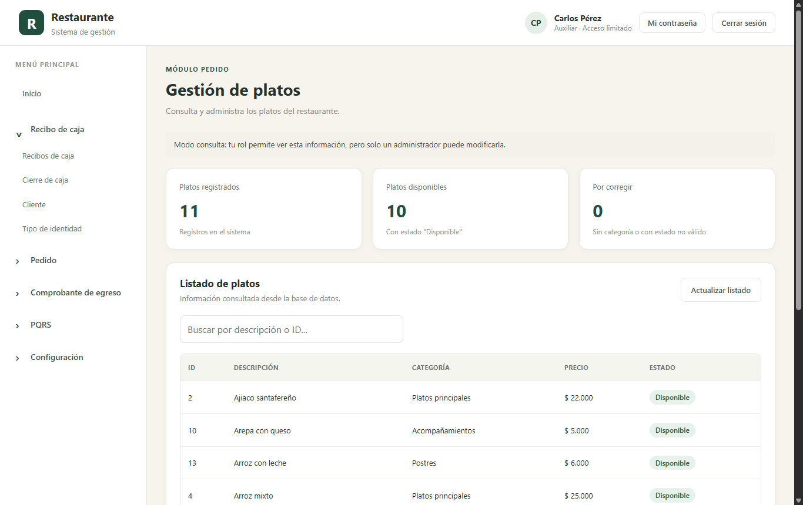

# 4. Usuarios y perfiles

El sistema tiene dos perfiles. Ninguno necesita conocimientos técnicos: basta con saber usar un navegador y conocer el trabajo del restaurante.

| Perfil | Quién lo usa | Habilidades necesarias |
| --- | --- | --- |
| Administrador (Admin) | Dueño o encargado del restaurante | Manejo básico del computador; conoce precios, proveedores y reglas de caja |
| Auxiliar | Meseros, cocina y caja | Manejo básico del navegador o la tableta |

## Opciones por perfil

| Módulo | Opción | Administrador | Auxiliar |
| --- | --- | --- | --- |
| Inicio | Resumen del restaurante | Consultar | Consultar |
| Pedido | Pedidos: crear, agregar platos, finalizar, cancelar | Sí | Sí |
| Pedido | Cocina / Comandas: marcar platos listos | Sí | Sí |
| Pedido | Materias primas | Crear y editar | Crear y editar |
| Pedido | Platos, Categorías, Categorías de insumo, Unidades de medida | Crear y editar | Solo consultar |
| Recibo de caja | Recibos de caja: cobrar | Sí | Sí |
| Recibo de caja | Recibos de caja: anular | Sí, con motivo | No |
| Recibo de caja | Cierre de caja | Sí | Sí |
| Recibo de caja | Cliente | Crear y editar | Crear y editar |
| Recibo de caja | Tipo de identidad | Crear y editar | Solo consultar |
| Comprobante de egreso | Comprobantes de egreso: registrar y anular | Sí | Solo consultar |
| Comprobante de egreso | Concepto de pago, Forma de pago | Crear y editar | Solo consultar |
| PQRS | Bandeja de PQRS: registrar y responder | Sí | Sí |
| PQRS | Tipo de PQRS | Crear y editar | Solo consultar |
| Configuración | Usuario, Rol | Crear y editar | No ve la opción |
| Configuración | Estados | Crear y editar | Solo consultar |
| Todos | Mi contraseña | Sí | Sí |

Cuando un auxiliar abre una pantalla de solo consulta, ve el aviso _Modo consulta_ y no aparecen los botones para crear o editar.

<figure><figcaption>
Figura 4. Pantalla de Platos vista por un auxiliar, en modo consulta
</figcaption></figure>
